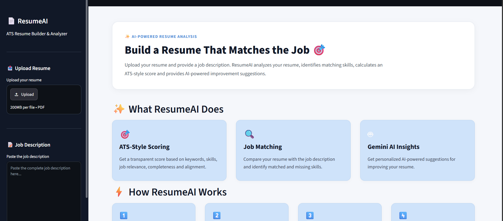
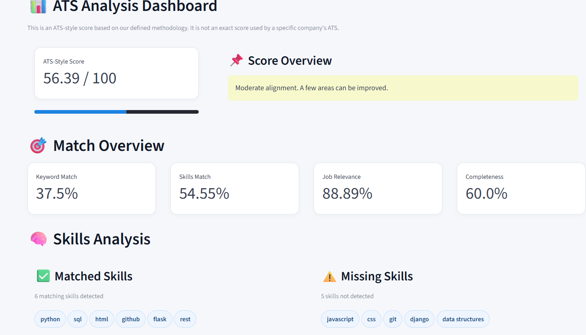
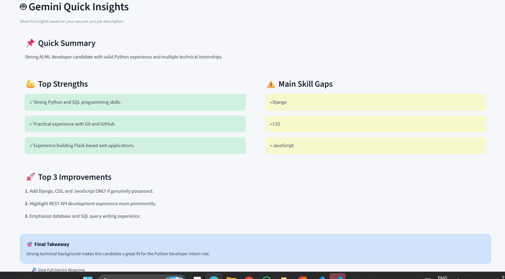

# 🤖 ResumeAI — AI-Powered ATS Resume Builder

ResumeAI is an AI-powered resume analysis and job-matching application designed to help users improve their resumes for Applicant Tracking Systems (ATS).

## ✨ Features

- 📄 Resume analysis
- 🎯 ATS-style resume scoring
- 🔍 Job description matching
- 🧠 AI-powered resume suggestions
- 📝 Identification of missing or weak areas
- 💡 Suggestions for improving resume-job alignment

## 🛠️ Technologies Used

- Python
- Streamlit
- Google Gemini API
- PDF Processing
- AI / Natural Language Processing

## ⚙️ How It Works

1. Upload your resume.
2. Provide the target job description.
3. ResumeAI analyzes the resume.
4. The application evaluates important skills and keywords.
5. AI generates improvement suggestions.
6. The user can improve the resume based on the analysis.

## 🔐 Security

API keys are stored using environment variables and are excluded from the repository using `.gitignore`.

> Never add your API key directly to the source code or commit it to GitHub.
>
> ## ⚙️ How It Works

1. Upload your resume.
2. Provide the target job description.
3. ResumeAI analyzes the resume.
4. The application evaluates important skills and keywords.
5. AI generates improvement suggestions.
6. The user can improve the resume based on the analysis.

## 📸 Screenshots

### 🏠 ResumeAI Dashboard

### 📊 ATS Analysis Dashboard

### 🤖 AI-Powered Insights

## 🚀 Future Improvements

- Resume template generation
- More advanced ATS analysis
- Resume keyword optimization
- Multiple resume formats
- Enhanced job matching
- Deployment as a public web application

## 👩‍💻 Author

**Roma Banik**

BCA Student | Technology Enthusiast

---

⭐ If you find this project useful, consider giving it a star!
